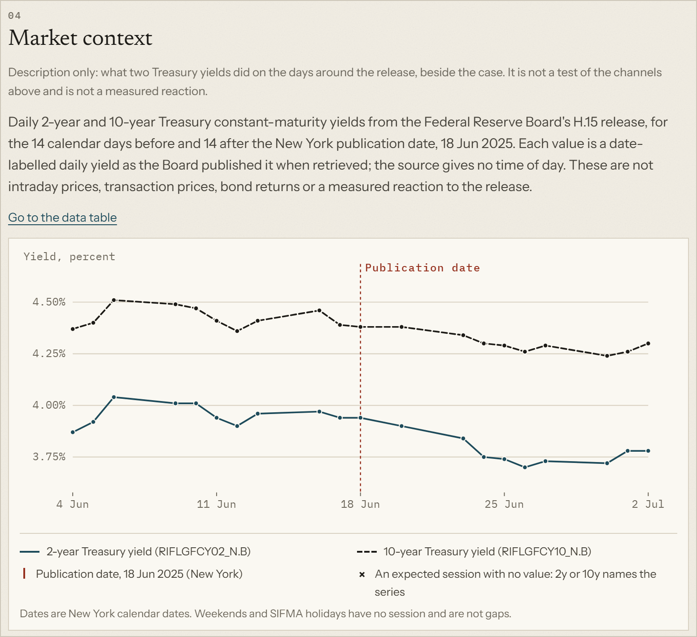
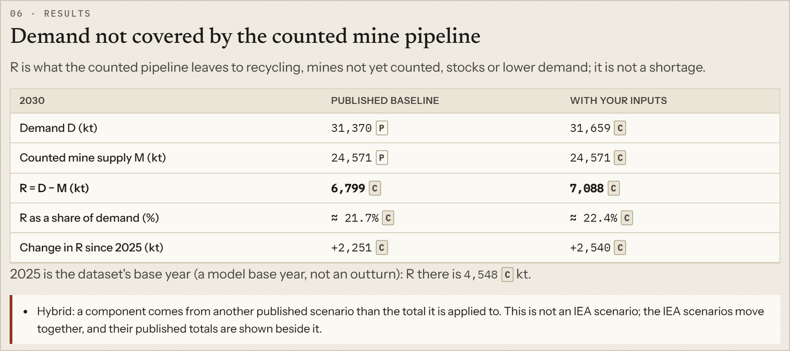
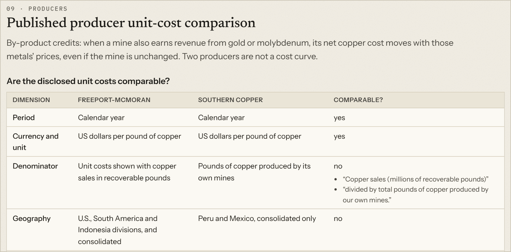
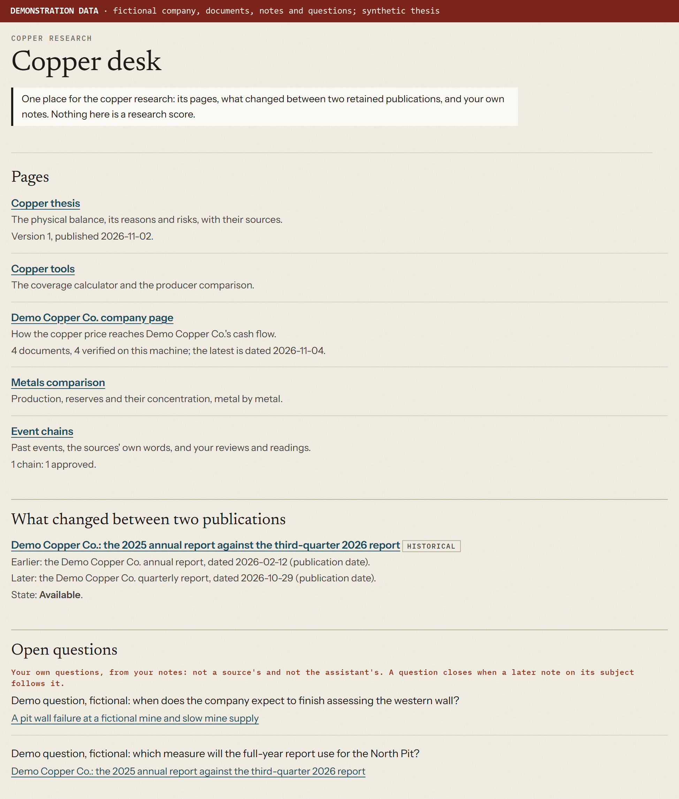
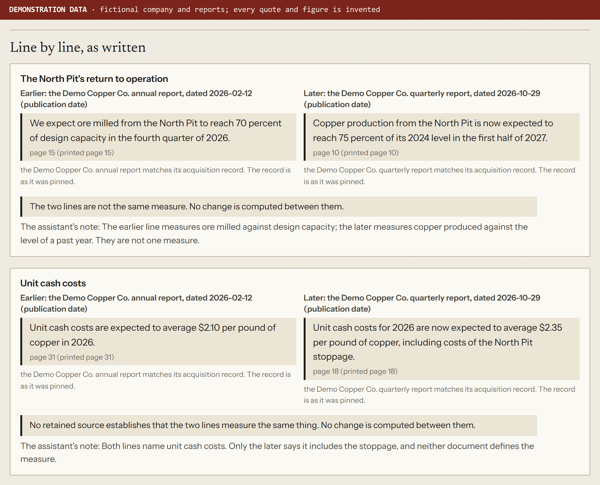
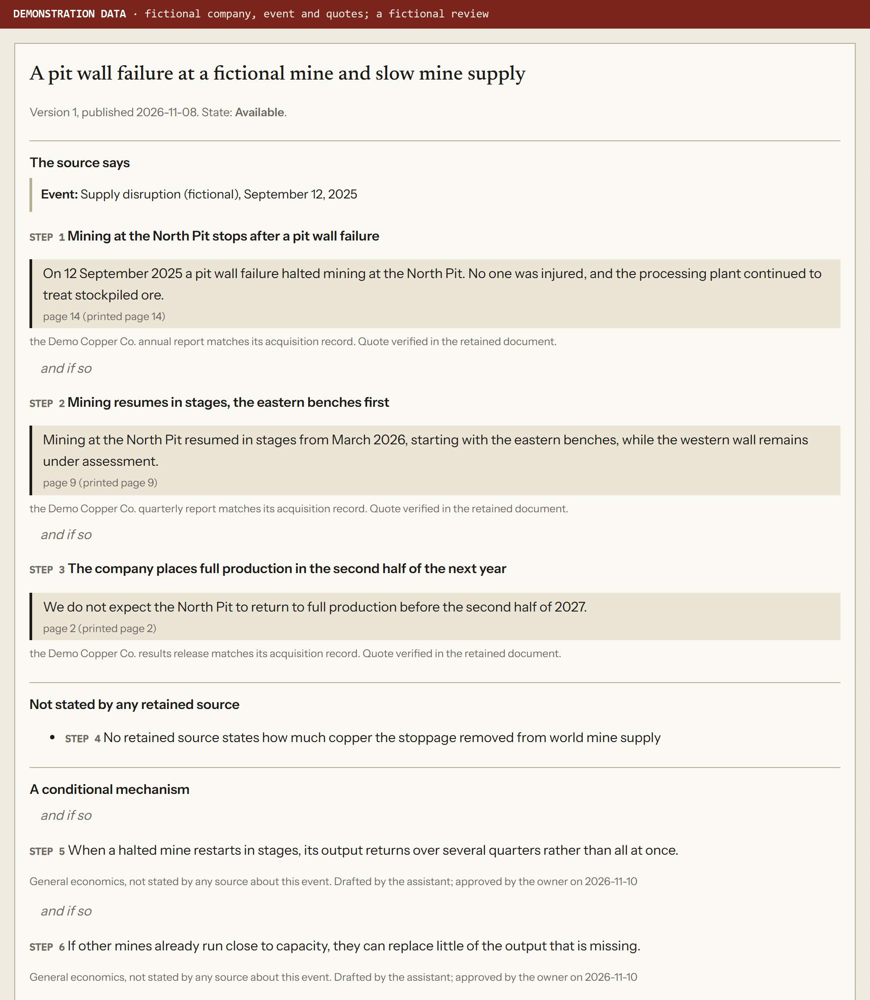
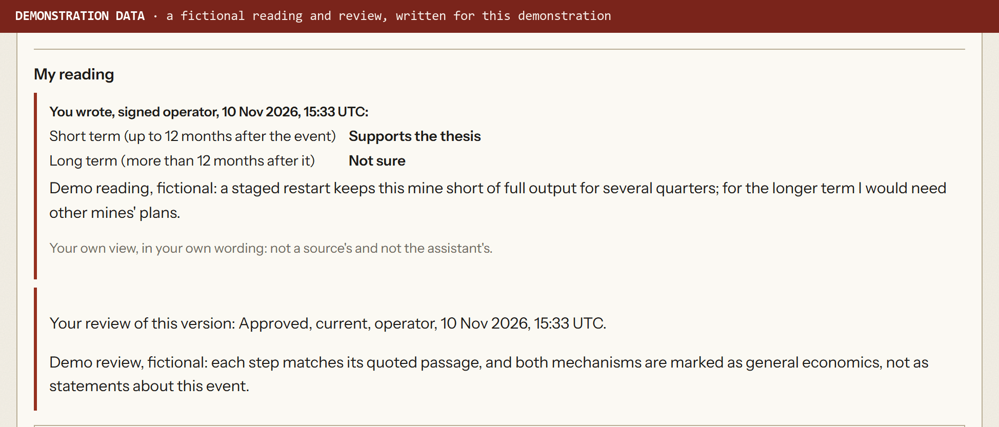
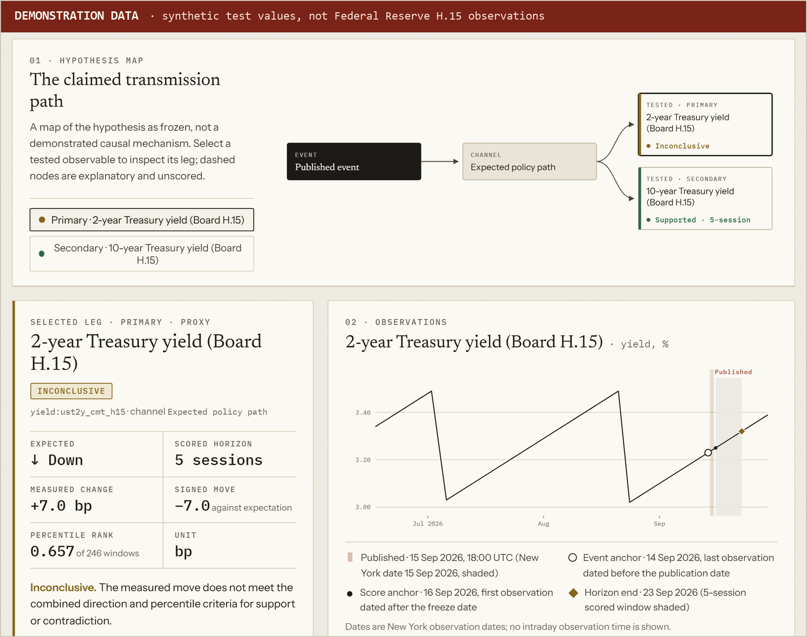

# Second Order

**Economic research across macroeconomics, commodities, and company fundamentals.**

Second Order connects economic events, sector dynamics, and company fundamentals in a structured research workflow. It brings together primary sources, commodity data, company financials, and hypothesis evaluation—making the evidence and assumptions behind each analysis accessible.

*Company exposure, from the copper thesis: how a change in the copper price can reach a producer's revenue, margin and
operating cash flow, beside the sensitivity the company states in its annual report and the passage it is taken from.*

With Second Order, an analyst can read an official release and see what changed, follow a commodity from its demand
drivers to its supply, trace how a price move reaches a company's accounts, and set two of a company's reports side by
side. The analyst can also follow a company event to the reasons behind a commodity view, and record a hypothesis or a
personal expectation before the outcome is known.

## Core capabilities

**Economic event research.** Structured readings of official releases: Federal Reserve decisions, employment and
inflation reports, energy analysis, export controls, industrial production, bank balance sheets and trade news. Each
reading sets out what the release says, its key facts, competing explanations and what would weaken the
interpretation. Macroeconomic releases add possible channels to Treasury yields and the daily 2-year and 10-year yields
around publication. An event inbox collects new releases from official feeds, and Claude can sort selected headlines on
request.

**Sector and commodity research.** A versioned copper thesis lays out the physical balance from IEA and USGS data, the
reasons and risks behind the view, and the current status of each. Copper tools calculate how much projected demand
the counted mine pipeline leaves uncovered, using a published IEA scenario or the analyst's own inputs. A metals view
compares where 45 metals are produced, where their reserves sit, and how concentrated both are.

**Company analysis.** An exposure map follows a change in the copper price into the accounts of producers and users,
based on what their filings state. A producer comparison checks whether two companies' reported unit costs are measured
the same way before setting them side by side. A company page for Freeport-McMoRan traces volumes, realised prices,
unit costs and by-product credits to operating cash flow, using the company's own revenue bridge and sensitivities.
These views do not produce valuations or price targets.

**Copper desk and publication comparisons.** The copper desk brings the copper work together. It links the thesis, the
copper tools, the company page, the metals view and the event chains. For the thesis, the company's documents and the
chains it adds a status line taken from that page: the published version, the documents verified on this machine, and
each chain's review state. It also lists the publication comparisons, the analyst's notes and the questions those
notes leave open. A
publication comparison sets what two retained reports say on the same matters side by side, each line in the source's
own words with its page and date. Every row states whether the two lines are the same measure, with a short note on
what each one measures and when. No change is computed between two lines: comparing figures needs matching units and a
matching basis. The first comparison sets Freeport-McMoRan's 2025 annual report against its third-quarter 2026 report.

**Event chains.** An event chain follows one possible path from a past event in a retained source to a reason or risk
of the copper thesis. It keeps three voices apart:
- the source's quoted words;
- a general conditional mechanism, drafted by the assistant and marked as such;
- the analyst's own reading for the short and the long term, recorded after the analyst has reviewed and approved the
  chain.

Each chain version pins the passages it cites. When a cited record or document changes, the chain says so, and an
earlier approval or reading no longer counts as current. A chain is not evidence that the event caused anything, and
it is not a forecast. The measured block, which sits beside the chain and outside it, shows only what retained series
cover.

**Personal research notes.** Notes are the analyst's dated, append-only records about a comparison, a chain or the
thesis. A note can carry an expectation, a check-by date and a question for the next check. Notes are labelled as
personal views and kept apart from sources, AI drafts and research scores. A change of mind is a new note; nothing is
edited. A note written after both compared publications were known says so, and an expectation is recorded, never
scored.

**Hypothesis evaluation.** A hypothesis names the event, the channel, the market measure, the expected direction and
the horizon. Once its window has passed, the measured move is ranked against the measure's past moves, placebo dates
provide a baseline, and the result is labelled supported, contradicted or inconclusive. Market measurement is
currently connected for Treasury yields: the 2-year and 10-year yields, from the Federal Reserve's H.15 data. The rules
also describe how equities and ETFs would be measured, but no equity or ETF price source is connected, so a hypothesis
leg on them is recorded as unavailable.

## Example: from electricity demand to company financials

1. **Electricity demand.** Electrification, grid build-out and data centres raise a practical question: how much more
   copper does the power system need? The copper tools set out each link in that chain and whether the sources measure
   it, project it or only describe it.
2. **Copper.** IEA data split copper demand by technology, including electricity networks, alongside counted mine
   supply. Replacing the network component with the IEA's High Demand value adds 289 thousand tonnes to 2030 demand in
   the Stated Policies case, and widens the gap that counted mines leave to recycling, new mines and stocks.
3. **Company exposure.** The exposure map traces the copper price into producers' and users' accounts. Freeport-McMoRan,
   for example, estimates in its 10-K that each 10-cent change per pound moves its 2026 operating cash flow by about
   $330 million.
4. **Financial data and assumptions.** That estimate rests on the company's stated assumptions, including an average
   copper price of $5.00 per pound for 2026. The producer comparison then shows which reported unit costs can be
   compared and where the definitions differ.
5. **What the company said next.** A publication comparison sets the annual report beside the third-quarter report,
   row by row, and marks whether two figures measure the same thing. An event chain links a disruption at one of the
   company's mines to the thesis's reason on mine supply. There the analyst can record a dated reading, and a note
   with a question for the next report.

## Screenshots

Images marked DEMONSTRATION DATA use fictional or synthetic data. The others show retained public sources.

*Event research. The June 2025 FOMC statement with daily 2-year and 10-year Treasury yields for two weeks on either
side, from the Federal Reserve Board's H.15 release. The chart gives context; it does not attribute a market reaction to
the statement.*

*Commodity research. Copper demand not covered by the counted mine pipeline in 2030, under the IEA's published
baseline and with the electricity-network component changed. P marks a published figure and C a computed one; the page
flags the mixed case as a hybrid, not an IEA scenario. Data: IEA Critical Minerals Dataset 2026 (CC BY 4.0).*

*Company analysis. Before Freeport-McMoRan's and Southern Copper's unit costs are compared, each definition is checked
against the companies' 10-K wording. Here the denominator and the geographic scope differ, so the reported figures are
not directly comparable.*

*The copper desk, shown with demonstration data: Demo Copper Co., its reports and the notes are fictional, and the
thesis is synthetic. Each copper page has its status line, followed by the comparison of two reports and the open
questions from the analyst's notes.*

*A publication comparison, shown with demonstration data (a fictional company and fictional reports). The first row's
lines are not the same measure: ore milled against design capacity, and copper produced against an earlier year. For
the second, no source establishes that the two lines share a basis. No change is computed between them.*

*An event chain, shown with demonstration data (a fictional company, event, review and reading). Above: the source's
quoted words, a step that no retained source states, and two conditional mechanisms, each marked as general economics
drafted by the assistant. Below: the analyst's reading for the short and the long term, marked as the analyst's own
view, and the review that approved the chain. On the page, the thesis reason the chain bears on and the measured block
sit between the two.*

*Hypothesis evaluation, shown with demonstration data. The hypothesis expected the 2-year Treasury yield to fall over
five sessions; the Dossier shows the claimed transmission path, the measured move against that expectation, and its
percentile rank among past windows.*

## Methodology

- **Linked sources.** Figures link to the document, page or table cell they come from. Retained source files are
  checked against their download records whenever a page is read; figures that rest on a missing or altered file are
  withheld.
- **Facts, calculations, assumptions and views kept apart.** Numbers are marked as published in a source, computed by
  fixed code with the formula and inputs available, or set by the analyst. Company estimates are labelled separately
  from reported results. AI-drafted text is labelled as such and kept apart from sourced figures. The analyst's notes
  and readings are marked as personal views and are not part of any research score.
- **Definitions checked before figures are compared.** The producer comparison checks each company's unit-cost
  definition before setting two figures side by side. A publication comparison says whether two lines are the same
  measure and computes no change between them.
- **Hypotheses recorded before evaluation.** On the prospective path, a hypothesis is frozen with a timestamp before
  its outcome is known and cannot be edited; it is evaluated only in a separate, explicit step under rules set in
  advance. Retrospective reconstructions, built after the outcome was known, are demonstrations. Results describe the
  evidence; they do not establish causation. The prospective pilot on eight FOMC statements, starting on 1 December
  2026, is a showcase: its results stay out of research scores, and its start does not create a verified forecasting
  record.

## Technology

Python (FastAPI, Pydantic, SQLite) · React and TypeScript · Claude API for drafting, headline triage and briefs, each
request sent only after explicit approval.

Installation, local operation and source terms are covered in the [development guide](docs/DEVELOPMENT.md). The full
specification is in [SPEC.md](SPEC.md).
